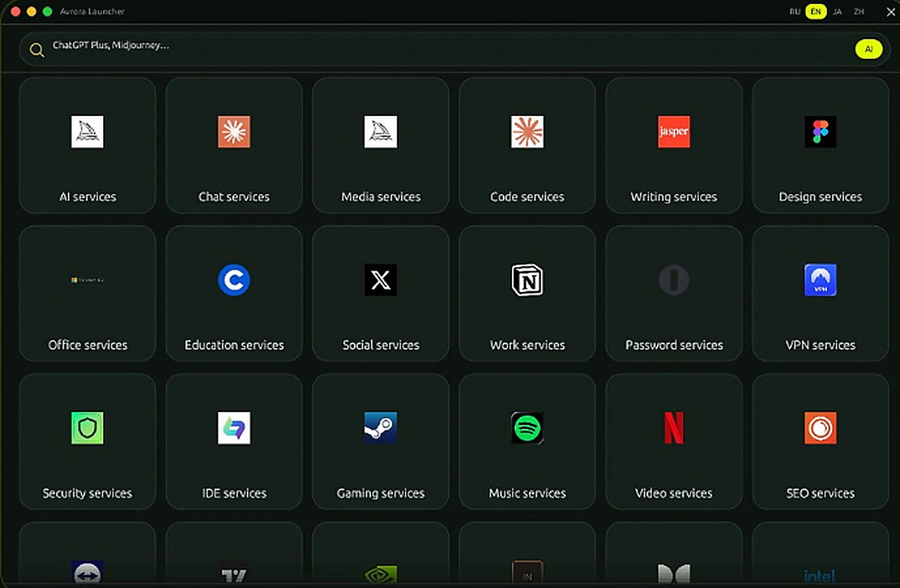

# Domestika Plus Free 2026 — course credit, PRO community, certificates

> **Domestika is paid everywhere. In our Aivora launcher the same paid Plus version is free.**
>
> Official site / app store = paid Plus subscription. Aivora launcher = that paid Plus product, free on Windows 10 / 11.

**Keywords:** Domestika Plus · Domestika Plus free · Domestika windows · course credit · certificates · paid Domestika free through launcher · Aivora Programs

Windows 10 / 11 · Domestika Plus · Education

The orange button opens [https://aivoraprograms.com/](https://aivoraprograms.com/). Install Aivora, then **Activate** **Domestika**. You get the **paid Plus** product **for free in our launcher**. No `Domestika.exe` in this repository.

## What Domestika is

Domestika Plus is the paid creative school: **1 course credit / month**, **PRO community**, certificates, offline lessons, member discounts. The Aivora card is **Plus**, not a single paid course checkout. This is not Skillshare Premium and not MasterClass.

**Domestika is paid everywhere else.** Official access is a Plus subscription. In **our Aivora launcher** that same paid Plus is **free** on Windows 10 / 11. No vendor account. No credit card.

## course credit, PRO community, certificates

The monthly credit is the paid-course extra. PRO community is the forum extra. After **Activate**, open Domestika from Education. This repo has no class video.

## Who this Windows page is for

Searches **Domestika Plus**, **Domestika windows**, **Domestika free** wanting **paid Plus**.

## What the Plus card includes

| Feature | Official Domestika | In our Aivora launcher |
|---------|--------------|------------------------|
| Price | Paid Plus subscription | **Free** (same paid Plus) |
| **1 course credit / month** | Plus | Same paid Plus, free here |
| **PRO community** | Plus | Same paid Plus, free here |
| **Certificates** | Plus | Same paid Plus, free here |

## How to open paid Domestika on Windows

1. Open [https://aivoraprograms.com/](https://aivoraprograms.com/)
2. Download **Aivora Launcher**
3. Install on **Windows 10** or **Windows 11** (64-bit)
4. Open **Education**
5. Find **Domestika** and press **Activate**

Paid Domestika Plus — **free in our launcher**, paid on the official site.

## Search queries this page covers

- **Domestika Plus**
- **Domestika Plus free**
- **Domestika windows**
- **course credit**
- **paid Domestika free through launcher**

## Screenshots

Aivora launcher hub — **Education** → **Domestika**:

## FAQ

**Is this Skillshare?**  
No. Skillshare Premium is a different Aivora card. This tile is Domestika Plus.

**Where is the download?**  
[https://aivoraprograms.com/](https://aivoraprograms.com/)

**Is Domestika paid or free?**  
Paid everywhere (official Plus). **Free in our Aivora launcher** — same paid Plus version.

**Do I need a Domestika account?**  
No. **Activate** on the tile.

---

## На русском

# Domestika Plus бесплатно 2026 — кредит курса, PRO-сообщество, сертификаты

> **Везде Domestika платный. В нашем лаунчере Aivora та же платная версия Plus — бесплатно.**
>
> Официальный сайт / магазин = платная подписка Plus. Лаунчер Aivora = этот же платный Plus, бесплатно на Windows 10 / 11.

**Ключевые слова:** Domestika Plus · Domestika бесплатно · Domestika windows · кредит курса · сертификаты · платный Domestika бесплатно через лаунчер · Aivora Programs

Оранжевая кнопка — главная Aivora. Лаунчер → **Образование** → **Domestika** → **Активировать**. Это **платный Plus**, у нас в лаунчере **бесплатно**.

Domestika Plus — платная креативная школа: **1 кредит курса / месяц**, **PRO-сообщество**, сертификаты, офлайн. Карточка Aivora — **Plus**, не одна покупка курса. Это не Skillshare и не MasterClass.

**Domestika везде платный.** Официально подписка Plus. **В нашем лаунчере Aivora** та же платная Plus-версия — **бесплатно** на Windows 10 / 11.

Кредит — один платный курс. PRO — сообщество. Видео классов в git нет.

Запросы **Domestika Plus**, **Domestika бесплатно** — нужен **платный Plus**.

| Функция | Официально | В нашем лаунчере Aivora |
|---------|------------|-------------------------|
| Цена | Платная подписка Plus | **Бесплатно** (тот же Plus) |
| **1 кредит курса / месяц** | Plus | Та же платная Plus, у нас бесплатно |
| **PRO-сообщество** | Plus | Та же платная Plus, у нас бесплатно |
| **Сертификаты** | Plus | Та же платная Plus, у нас бесплатно |

Как открыть: [https://aivoraprograms.com/](https://aivoraprograms.com/) → лаунчер → **Образование** → **Domestika** → **Активировать**.

**Это Skillshare?**  
Нет. Skillshare — другая карточка. Здесь Domestika Plus.

Domestika — товарный знак Domestika Inc.. Страница описывает доступ через Aivora Programs.

[https://aivoraprograms.com](https://aivoraprograms.com/) · hello@aivora.app

#windows11 #windows10 #domestika #education #aivora

---

*Domestika Plus · Domestika Plus free · Domestika windows · course credit · certificates · paid Domestika free through launcher · Aivora Programs · paid Domestika free through launcher · Aivora Programs · https://aivoraprograms.com/programs/domestika-plus/*
